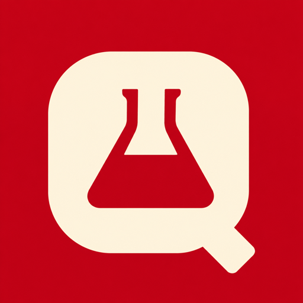

# Qiangsheng Lab

We're an open-source software lab. We build tools for the small problems developers run into again and again, and we document our experiments so others can reuse what works.

A command you retype every day or a pair of files you compare by hand each week could be our next experiment. [Suggest an idea](https://github.com/qiangsheng-lab/.github/issues/new) and tell us how you do it today and which step takes the most effort.
